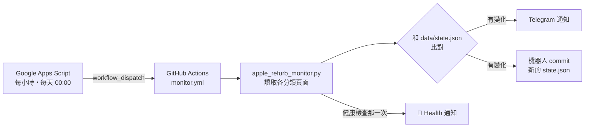

# Apple 台灣整修品 Telegram 監控器

每小時檢查一次 [Apple 台灣官方整修品商店](https://www.apple.com/tw/shop/refurbished)，有新上架、下架、降價或漲價就傳 Telegram 通知你。每天午夜另外傳一則健康通知，讓你知道監控還在運作。

不需要伺服器：排程用 Google Apps Script，檢查在 GitHub Actions 上跑，通知走 Telegram Bot，全部免費。

**需要準備**：GitHub 帳號、Google 帳號、Telegram。照著[設定](#設定)一步步做大約 15 分鐘，不需要會寫程式。只想使用的話，看完「設定」和「篩選條件」就夠了；最後的「給開發者」那部分可以跳過。

## 運作方式



1. Apps Script 每小時呼叫 GitHub 的 `workflow_dispatch`，啟動 `monitor.yml`。
2. `apple_refurb_monitor.py` 讀取 Apple 各分類頁面裡的商品資料（`REFURB_GRID_BOOTSTRAP`），套用篩選條件。
3. 和上一次存下來的 `data/state.json` 比對：有變化才傳 Telegram，並由 GitHub Actions 機器人把新的快照 commit 回 repository；沒變化就什麼都不做。
4. 每天台北時間 00:00 左右，Apps Script 另外觸發一次「健康檢查」：一樣完整檢查一次商品，成功後多傳一則 Health 通知。

為什麼不用 GitHub 原生的 `schedule`：它常常延遲好幾個小時、尖峰時段甚至會整次跳過；Apps Script 的觸發器準時得多（誤差約 15 分鐘內）。兩種同時用會重複觸發，所以只用 Apps Script。

## 會收到哪些通知

| 通知 | 什麼時候 |
|---|---|
| 🍎 Apple 台灣整修品更新 | 有新上架、下架、降價或漲價時。同一次的變化彙總成一則，開頭列出各類數量；價格異動顯示舊價 → 新價。太長時自動分成續篇，每則都保留完整的數量 |
| 💚 Apple 整修品監控 Health | 每天台北時間 00:00 左右（前後約 15 分鐘），內容是檢查時間與目前追蹤幾項商品。只有這次檢查有完成才傳；如果有分類出問題（見下面），會在這則通知裡用 ⚠️ 列出來 |
| ⚠️ Apple 整修品監控執行失敗 | **所有分類都讀不到**時（例如 Apple 整站改版、GitHub 連不上 Apple），或 GitHub Variables 的設定填錯時（訊息會寫是哪個設定）。這時會停下來報錯，不會把全部商品誤報成下架 |
| ✅ Apple 整修品監控已啟動 | 第一次執行（還沒有 `data/state.json`）建立基準資料時 |

**哪天午夜沒收到 Health 通知，就代表有地方壞了**，見下面的[疑難排解](#疑難排解)。

### 單一分類出問題時

一個分類出錯不會讓整次檢查失敗，其他分類照常檢查、照常通知：

| 狀況 | 怎麼處理 |
|---|---|
| Apple 拿掉了這個分類的頁面（404） | 當作 0 項。上次還有商品的話，會先隔 20 秒重新讀取最多兩次，確定不是暫時異常 |
| 讀取失敗（網路逾時、Apple 改了頁面結構等） | 沿用上次的商品，不會誤報下架或上架 |
| 頁面正常但突然變成 0 項（上次還有商品） | 隔 20 秒重新讀取最多兩次，還是 0 項才當作真的賣完 |

這些狀況不會每小時傳 Telegram 吵你，而是：GitHub Actions 的執行仍然是綠色 ✅，但會出現黃色的警告；如果午夜那次檢查時問題還在，Health 通知裡會用 ⚠️ 列出來（白天短暫出現、午夜前就恢復的問題，只會留在 Actions 的警告裡）。

## 費用

全部免費：

- **GitHub Actions**：這個 repository 是公開的，Actions 不計分鐘數。私人 repository 也能用，但每次只跑幾秒也會算 1 分鐘，每小時一次一個月約 750 分鐘（免費方案每月 2,000 分鐘）。
- **Google Apps Script、Telegram Bot**：免費。

## 設定

### 1. 建立 Telegram Bot

1. 在 Telegram 聯絡 `@BotFather`，輸入 `/newbot` 建立 Bot，取得 Bot Token。
2. 開啟自己的 Bot 並按 **Start**（或傳一則訊息給它）。
3. 在瀏覽器開啟下面的網址，找到回傳資料中的 `message.chat.id`，這就是 Chat ID：

   ```text
   https://api.telegram.org/bot<你的 BOT TOKEN>/getUpdates
   ```

   - 網址裡的 `bot` 和 Token 中間沒有空格，也不用保留 `<>`，例如 `https://api.telegram.org/bot123456:ABC-xyz/getUpdates`。
   - 看到 `{"ok":true,"result":[]}`（空的）：Telegram 只保留最近一段時間的訊息。再傳一則訊息給 Bot，重新整理網頁就會出現。
   - 個人聊天的 Chat ID 是一串正整數，例如 `123456789`。

**想讓通知傳到群組**（例如跟朋友共用）：

1. 把 Bot 加進群組。
2. 在群組裡傳 `/start@你的Bot帳號`（Bot 預設只看得到 `/` 開頭的指令，一般訊息不會出現在 `getUpdates`）。
3. 重新開啟上面的 `getUpdates` 網址，找群組那則訊息的 `message.chat.id`。群組的 Chat ID 是負數，例如 `-1001234567890`，**負號也要一起填**。

> 頻道也可以：把 Bot 設成頻道管理員，在頻道發一則貼文，到 `getUpdates` 找 `channel_post.chat.id`。

> 不要把 Bot Token 寫進程式或貼到公開的地方。萬一曝光，到 BotFather 撤銷並重新產生。

### 2. 設定 GitHub

1. 把這個專案複製一份到自己的帳號，二選一：
   - **Fork**（最簡單）：按右上角 **Fork**。fork 出來的 repository 一定是公開的，**沒辦法改成私人**；預設也會停用 Actions，要到 **Actions** 頁面按啟用。
   - **想要私人 repository**：到 [github.com/new/import](https://github.com/new/import)，舊 repository 的網址填這個專案的網址，選 **Private**。私人 repository 會用到 Actions 免費分鐘數，見[費用](#費用)。
2. **刪掉 `data/state.json`**（在 GitHub 網頁上點開檔案 → 🗑️ → Commit）。這是原作者的商品快照，留著的話第一次執行會拿它來比對，你會收到一堆跟你的篩選條件無關的變化通知，也收不到「已啟動」通知。
3. **Settings → Secrets and variables → Actions → Secrets**，新增 `TELEGRAM_BOT_TOKEN` 與 `TELEGRAM_CHAT_ID`。
4. （選用）在同一頁的 **Variables** 設定[篩選條件](#篩選條件)。
5. **Actions → Apple Refurbished Monitor → Run workflow** 手動執行一次：第一次會建立基準資料並傳送「已啟動」通知。勾選 `health_check` 再執行一次，可以先看看 Health 通知長什麼樣子。

> **之後不要按 GitHub 的「Sync fork」。** 原作者的 repository 每小時都會 commit 新的 `data/state.json`，同步時會把它帶回你的 repository（或卡在衝突），下一次執行就會拿原作者的快照來比對，傳一堆無關的通知。想拿到程式的更新，只要手動把 `apple_refurb_monitor.py`（以及有改到的 `.github/workflows/`）複製過來；`Code.gs` 有更新的話，記得到 Apps Script 也貼一份。不小心同步了的話，照第 2 步再刪一次 `data/state.json`，然後手動執行一次重建基準。

### 3. 設定 Google Apps Script 排程

1. 到 [script.google.com](https://script.google.com) 建立專案，把 `google_apps_script/Code.gs` 的內容整個貼上，**把開頭的 `GITHUB_REPOSITORY` 改成你自己的 `帳號/repository名稱`**（不改的話會去觸發原作者的 repository，GitHub 會回 404）。
2. 建立 GitHub fine-grained token：**Settings → Developer settings → Personal access tokens → Fine-grained tokens**，Repository access 只選這個 repository，權限只給 **Actions: Read and write**（觸發 workflow 需要）。到期日建議設一年內，**順手在行事曆記一筆「到期前換 token」**：token 過期後唯一的症狀是午夜不再收到 Health 通知，很容易沒發現。
3. Apps Script 的 **專案設定 → 指令碼屬性**，新增 `GITHUB_TOKEN`，值貼上剛才的 token。
4. 在編輯器上方的函式選單選 `triggerAppleRefurbMonitor`，按 **執行**，到 GitHub 的 Actions 頁面確認有一次新的執行。第一次執行會要求授權：
   - 選你的 Google 帳號後，會看到「**Google 尚未驗證這個應用程式**」。這是因為腳本是你自己建立的、沒有送 Google 審核，不是有問題。
   - 點左下角 **進階** → **前往「（專案名稱）」（不安全）** → **允許**。
   - 腳本要的權限是「連線到外部服務」（呼叫 GitHub API）和「在你不在時執行」（觸發器），不會讀取你的 Gmail 或雲端硬碟。
5. 執行 `installMonitorTrigger`：建立兩個觸發器，**每小時檢查一次**、**每天台北時間 00:00 健康檢查**。可以重複執行，它會先清掉舊的觸發器再建立。

`Code.gs` 開頭可以調整：

| 設定 | 預設 | 說明 |
|---|---|---|
| `GITHUB_REPOSITORY` | `Teng91/apple-refurb-monitor` | 要觸發的 repository，換成你自己的 |
| `GITHUB_REF` | `main` | 在哪個分支上執行 workflow |
| `MONITOR_INTERVAL_HOURS` | `1` | 幾小時檢查一次（Apps Script 只接受 1、2、4、6、8、12） |
| `HEALTH_HOUR` | `0` | 每天台北時間幾點傳健康通知（0–23） |
| `DISPATCH_RETRY_DELAYS_SECONDS` | `[10, 30, 60]` | GitHub 回 5xx、429 或連線失敗時，每次重試前等幾秒；401、404、422 這類錯誤不會重試 |

改了之後要再執行一次 `installMonitorTrigger` 才會生效。repository 裡的 `Code.gs` 只是副本，真正在跑的是 Apps Script 專案裡那份：兩邊要一起改。

## 篩選條件

在 GitHub 的 **Settings → Secrets and variables → Actions → Variables** 加入以下任意變數：

| Variable | 範例 | 說明 |
|---|---|---|
| `APPLE_CATEGORIES` | `mac,ipad` | 要追蹤的分類，預設全部：`mac,ipad,homepod,appletv,accessories`（Apple 台灣已在 2026 年 11 月拿掉 AirPods 整修品頁面）。|
| `INCLUDE_KEYWORDS` | `MacBook Pro,M5` | 名稱或 SKU 至少包含其中一項 |
| `EXCLUDE_KEYWORDS` | `Studio Display` | 排除包含任一關鍵字的商品 |
| `MAX_PRICE_TWD` | `60000` | 只追蹤不超過這個價格（台幣）的商品。只能填整數，千分位逗號可以（`60,000`）；填成 `6萬` 這類格式會收到「設定錯誤」通知 |

多個關鍵字用半形逗號分隔，不分英文大小寫。改了篩選條件之後，下一次執行可能會把被排除的舊商品當成「下架」通知；不想收到這批通知的話，先刪掉 `data/state.json` 再手動執行一次，重新建立基準。

## 疑難排解

**午夜沒收到 Health 通知**

1. 到 GitHub 的 **Actions** 頁面，看 00:00 左右有沒有一次執行。
   - **沒有**：Apps Script 沒有觸發成功。到 Apps Script 的「執行項目」看錯誤，最常見的是 `GITHUB_TOKEN` 過期（GitHub 回 401），重新產生後更新指令碼屬性。GitHub 偶爾會回 500 這類暫時錯誤，`Code.gs` 會自動重試 3 次，全部失敗才算失敗。Apps Script 預設也會寄信通知觸發失敗。
   - **有，但失敗**：通常會收到「執行失敗」的 Telegram 通知；沒收到的話點進那次執行看 log。
   - **有，而且成功**：檢查 `TELEGRAM_BOT_TOKEN`、`TELEGRAM_CHAT_ID` 兩個 Secrets，以及 Bot 有沒有被封鎖。傳到群組的話，確認 Chat ID 有包含開頭的負號、Bot 還在群組裡。
2. 也可以手動執行 `triggerDailyHealthCheck`，或在 Actions 頁面勾選 `health_check` 執行，馬上測一次整條流程。

**一次收到很多「下架」**：多半是剛改了篩選條件，見[篩選條件](#篩選條件)。

**Health 通知裡出現「讀取失敗，沿用上次的 N 項商品」**：這個分類這次讀不到（網路問題或 Apple 改了頁面結構），先沿用上次的商品，不會誤報下架。只出現一次通常是暫時的；連續幾天都有，而且原因是「找不到 REFURB_GRID_BOOTSTRAP」，代表 Apple 改了頁面結構，要更新 `parse_bootstrap`。

**Health 通知裡出現「Apple 沒有這個分類的頁面（404）」**：Apple 拿掉了這個分類（例如 2026 年 11 月拿掉 AirPods），這個分類會當作 0 項。可以從 `APPLE_CATEGORIES` 或程式的 `DEFAULT_CATEGORIES` 拿掉它。

## 注意事項

### 公開 repository 的安全性

- 程式碼、`data/state.json`、commit 紀錄（包含作者 email）與 Actions 執行紀錄任何人都看得到。
- Bot Token、Chat ID 存在 GitHub Secrets，不會公開；就算出現在執行紀錄裡也會自動遮蔽。觸發用的 GitHub token 只存在 Apps Script 的指令碼屬性，不在 repository 裡。
- workflow 只接受 `workflow_dispatch`：只有對 repository 有寫入權限的人（或持有 token 的 Apps Script）能觸發。別人 fork 或開 PR 都不會執行這個 workflow，也拿不到你的 Secrets。
- Apps Script 用的 token 只給這一個 repository 的 **Actions: Read and write**，就算外洩也只能觸發或取消 workflow，改不了程式碼。到期前記得換新。
- 建議到 **Settings → Advanced Security**（舊版介面叫 Code security）開啟 Secret scanning 與 Push protection（公開 repository 免費），避免不小心 commit 出 token。

### 其他

- Apps Script 的觸發器不保證固定在哪一分鐘執行。
- 健康檢查那一次也會完整檢查商品，有變化一樣會通知。

## 給開發者

只是要使用的話不用看這一節。

### 檔案

| 檔案 | 說明 |
|---|---|
| `apple_refurb_monitor.py` | 讀取商品、篩選、比對、組 Telegram 訊息（只用 Python 標準函式庫） |
| `tests/test_monitor.py` | 單元測試：解析、篩選、比對、訊息分段、空分類重新讀取、單一分類出錯不中斷、Health 與錯誤通知 |
| `data/state.json` | 最新的商品快照；有變化時由 GitHub Actions 機器人 commit。`checked_at` 是最後一次有變化的時間 |
| `.github/workflows/monitor.yml` | GitHub Actions：執行檢查、把快照 commit 回來；`health_check` 參數決定要不要傳 Health 通知 |
| `.github/workflows/test.yml` | GitHub Actions：推上 `.py` 檔或開 PR 時自動跑單元測試 |
| `google_apps_script/Code.gs` | Apps Script 排程的原始碼副本：每小時觸發一次、每天午夜觸發一次健康檢查 |

### 本機測試

只用 Python 標準函式庫（GitHub Actions 上是 Python 3.12），不需要安裝任何套件。

macOS / Linux / Git Bash：

```bash
python3 -m unittest discover -s tests -v
DRY_RUN=true python3 apple_refurb_monitor.py                     # 實際讀取 Apple 頁面，Telegram 訊息只印出來
DRY_RUN=true HEALTH_CHECK=true python3 apple_refurb_monitor.py   # 連 Health 通知一起看
```

Windows PowerShell：

```powershell
python -m unittest discover -s tests -v
$env:DRY_RUN = "true"; python apple_refurb_monitor.py
```

`DRY_RUN` 只是不傳 Telegram，照樣會比對並更新 `data/state.json`。不想改到快照的話，把 `data/state.json` 複製到 `work/`，再設定 `STATE_FILE=work/state.json` 執行（`work/` 不會被 commit）。

程式讀取的環境變數：

| 環境變數 | 預設 | 說明 |
|---|---|---|
| `TELEGRAM_BOT_TOKEN`、`TELEGRAM_CHAT_ID` | （無） | Telegram 傳送用；`DRY_RUN` 時不需要 |
| `APPLE_CATEGORIES`、`INCLUDE_KEYWORDS`、`EXCLUDE_KEYWORDS`、`MAX_PRICE_TWD` | 見[篩選條件](#篩選條件) | 篩選條件 |
| `STATE_FILE` | `data/state.json` | 快照檔位置 |
| `NOTIFY_ON_FIRST_RUN` | `true` | 第一次建立基準時要不要傳「已啟動」通知 |
| `HEALTH_CHECK` | `false` | 檢查成功後多傳一則 Health 通知 |
| `DRY_RUN` | `false` | Telegram 訊息只印出來，不真的傳 |
