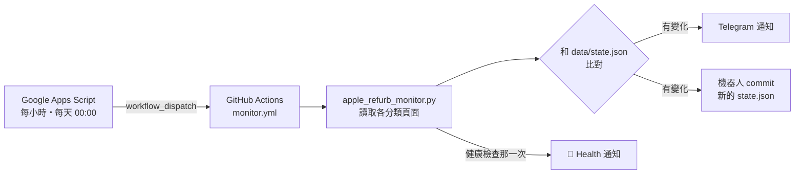

# 給開發者

只是要使用的話不用看這份文件，回到 [README](../README.md)。

## 運作流程



1. Apps Script 每小時呼叫 GitHub 的 `workflow_dispatch`，啟動 `monitor.yml`。
2. `apple_refurb_monitor.py` 讀取 Apple 各分類頁面裡的商品資料（`REFURB_GRID_BOOTSTRAP`），套用篩選條件。
3. 和上一次存下來的 `data/state.json` 比對：有變化才傳 Telegram，並由 GitHub Actions 機器人把新的快照 commit 回 repository；沒變化就什麼都不做。
4. 每天台北時間 00:00 左右，Apps Script 另外觸發一次「健康檢查」：一樣完整檢查一次商品，成功後多傳一則 Health 通知。健康檢查那一次有變化一樣會通知。

不用 GitHub 原生的 `schedule`：它常常延遲好幾個小時、尖峰時段甚至會整次跳過；Apps Script 的觸發器準時得多（誤差約 15 分鐘內，但不保證固定在哪一分鐘）。兩種同時用會重複觸發。

## 單一分類出問題時

一個分類出錯不會讓整次檢查失敗，其他分類照常檢查、照常通知：

| 狀況 | 怎麼處理 |
|---|---|
| Apple 拿掉了這個分類的頁面（404） | 當作 0 項。上次還有商品的話，會先隔 20 秒重新讀取最多兩次，確定不是暫時異常 |
| 讀取失敗（網路逾時、Apple 改了頁面結構等） | 沿用上次的商品，不會誤報下架或上架。網路錯誤會先重試 3 次 |
| 少數商品資料格式不符（例如缺價格） | 只略過那幾個商品；整頁的商品都無法解析才當作讀取失敗 |
| 同一個商品出現在兩個分類（例如 homepod 和 accessories） | 用 SKU 判斷是同一項，只通知一次；記在 `APPLE_CATEGORIES` 裡排比較前面的分類。某個分類讀取失敗時，這次有讀到的價格優先於上次的資料 |
| 頁面正常但突然變成 0 項（上次還有商品） | 隔 20 秒重新讀取最多兩次，還是 0 項才當作真的賣完 |

這些狀況不會每小時傳 Telegram：GitHub Actions 的執行仍是綠色 ✅，但會有黃色警告；午夜那次檢查時問題還在的話，Health 通知裡會用 ⚠️ 列出來。所有分類都讀不到時才會停下來報錯（「執行失敗」通知），不會把全部商品誤報成下架。

第一次建立基準資料時有分類讀取失敗，這次會直接報錯、不建立基準，下次執行再試；否則下一次會把那個分類的商品全部誤報為新上架。

## 通知與快照的順序

有變化時，程式先寫入 `data/state.json`、再傳 Telegram，最後由 workflow commit 回 repository。

- Telegram 遇到網路錯誤、5xx 或 429（太頻繁）會重試；429 會照 Telegram 指定的秒數等待。4xx（Chat ID 錯、Bot 被封鎖）不重試，錯誤訊息會附上 Telegram 給的原因（例如 `chat not found`）。
- 分段訊息傳到一半失敗：整次執行失敗、快照不會 commit，下一次會把整批重傳一次。寧可重複，不會漏掉。
- 快照 push 失敗（重試 3 次，衝突時會先 `git rebase --abort`）：通知已經傳出，workflow 會再傳一則「執行失敗」並附上執行紀錄的連結，因為修好之前每次執行都可能重複通知。

## 公開 repository 的安全性

- 程式碼、`data/state.json`、commit 紀錄（包含作者 email）與 Actions 執行紀錄任何人都看得到。
- Bot Token、Chat ID 存在 GitHub Secrets，不會公開；就算出現在執行紀錄裡也會自動遮蔽。觸發用的 GitHub token 只存在 Apps Script 的指令碼屬性，不在 repository 裡。
- workflow 只接受 `workflow_dispatch`：只有對 repository 有寫入權限的人（或持有 token 的 Apps Script）能觸發。別人 fork 或開 PR 都不會執行這個 workflow，也拿不到你的 Secrets。
- Apps Script 用的 token 只給這一個 repository 的 **Actions: Read and write**，就算外洩也只能觸發或取消 workflow，改不了程式碼。
- 建議到 **Settings → Advanced Security**（舊版介面叫 Code security）開啟 Secret scanning 與 Push protection（公開 repository 免費）。

## 檔案

| 檔案 | 說明 |
|---|---|
| `apple_refurb_monitor.py` | 讀取商品、篩選、比對、組 Telegram 訊息（只用 Python 標準函式庫）。`run()` 是主流程，通知函式和分類讀取函式都由參數傳入，測試不需要真的連網 |
| `tests/test_monitor.py` | 單元測試：解析、篩選、比對、訊息分段、空分類重新讀取、單一分類出錯不中斷、快照讀寫、Telegram 重試與錯誤原因、Health 與錯誤通知 |
| `data/state.json` | 最新的商品快照；有變化時由 GitHub Actions 機器人 commit。`checked_at` 是最後一次有變化的時間 |
| `.github/workflows/monitor.yml` | GitHub Actions：執行檢查、把快照 commit 回來；`health_check` 參數決定要不要傳 Health 通知 |
| `.github/workflows/test.yml` | GitHub Actions：推上 `.py` 檔或開 PR 時自動跑單元測試 |
| `google_apps_script/Code.gs` | Apps Script 排程的原始碼副本：每小時觸發一次、每天午夜觸發一次健康檢查 |
| `docs/ai-setup.md` | 給 AI 助理照著做的設定步驟 |

## 本機測試

只用 Python 標準函式庫（GitHub Actions 上是 Python 3.12），不需要安裝任何套件。

macOS / Linux / Git Bash：

```bash
python3 -m unittest discover -s tests -v
DRY_RUN=true python3 apple_refurb_monitor.py                     # 實際讀取 Apple 頁面，Telegram 訊息只印出來
DRY_RUN=true HEALTH_CHECK=true python3 apple_refurb_monitor.py   # 連 Health 通知一起看
```

Windows PowerShell：

```powershell
python -m unittest discover -s tests -v
$env:DRY_RUN = "true"; python apple_refurb_monitor.py
$env:HEALTH_CHECK = "true"; python apple_refurb_monitor.py   # 連 Health 通知一起看
Remove-Item Env:DRY_RUN, Env:HEALTH_CHECK                    # PowerShell 的環境變數會留在整個視窗，用完記得清掉
```

`DRY_RUN` 會照樣讀取 Apple、和 `data/state.json` 比對，但 Telegram 訊息只印出來，也**不會寫入** `data/state.json`，所以不會影響正式執行的比對結果。

程式讀取的環境變數：

| 環境變數 | 預設 | 說明 |
|---|---|---|
| `TELEGRAM_BOT_TOKEN`、`TELEGRAM_CHAT_ID` | （無） | Telegram 傳送用；`DRY_RUN` 時不需要 |
| `APPLE_CATEGORIES`、`INCLUDE_KEYWORDS`、`EXCLUDE_KEYWORDS`、`MAX_PRICE_TWD` | 見[篩選條件](../README.md#篩選條件) | 篩選條件 |
| `STATE_FILE` | `data/state.json` | 快照檔位置 |
| `NOTIFY_ON_FIRST_RUN` | `true` | 第一次建立基準時要不要傳「已啟動」通知 |
| `HEALTH_CHECK` | `false` | 檢查成功後多傳一則 Health 通知 |
| `DRY_RUN` | `false` | Telegram 訊息只印出來，不真的傳，也不寫入快照檔 |
